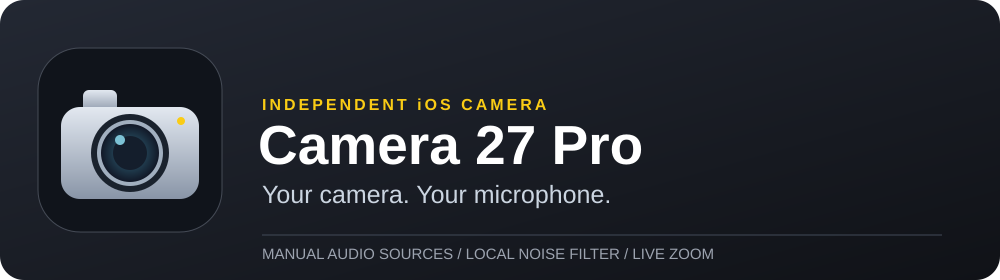
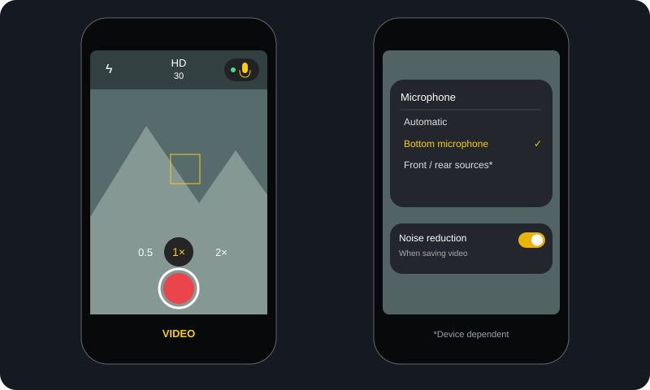

  
  
  

<a href="https://github.com/semedios/Camera27Pro-Releases/releases"><b>Downloads</b></a> · <a href="INSTALL.md">Installation</a> · <a href="https://github.com/semedios/Camera27Pro-Releases/issues">Feedback</a> · <a href="#українською">Українська</a> · <a href="#по-русски">Русский</a>

---

## Your camera. Your microphone.

Does your iPhone record clear voice memos but produce buzzing, hiss or hum when recording video? Camera 27 Pro is an independent native camera app that lets you select audio sources exposed by iOS, instead of relying solely on automatic selection.

It started as a personal workaround for an iPhone 11 with noisy video audio. The core microphone selection has been tested on that device. It is **not** a hardware repair or a guarantee that every physical microphone can be controlled independently.

## Highlights

| Feature | Details |
| --- | --- |
| Manual microphone selection | Choose available audio sources; verify the active route |
| Familiar camera controls | Photo, video, flash, exposure, focus and format selection |
| Video formats | HD / 4K and available frame rates, hardware permitting |
| Live zoom | Pinch and circular zoom control during recording (beta) |
| Noise reduction | Optional local post-processing at video save (experimental) |
| Offline operation | Recording and audio filtering are implemented locally |

## Download

**Beta v0.3.4** has passed its GitHub Actions build. Public IPA publication is pending; until an asset appears on the releases page, there is no public download.

[**View releases →**](https://github.com/semedios/Camera27Pro-Releases/releases)

- Requires iOS 16 or later; core audio routing tested on iPhone 11, other models not yet verified.
- The IPA is unsigned. You must sign it yourself for personal-device testing.
- Free personal signing generally expires after seven days; Developer Mode is required for development-signed builds.
- No jailbreak is required. This is not an App Store release.

Read the [installation guide](INSTALL.md) before installing. Do not send your Apple Account credentials or verification codes to anyone.

## Interface

<em>Interface illustration, not a captured device screenshot. Actual appearance may vary.</em>

## Beta limitations

Live zoom and optional noise reduction require further device testing. Physical lens changes during recording are restricted to preserve the capture session. The noise filter may also affect speech. Portrait blur, slow motion and timelapse are experimental; panorama is disabled. Available microphones vary by device and iOS audio routing.

## Feedback & support

Found a problem? [Report a bug](https://github.com/semedios/Camera27Pro-Releases/issues/new?template=bug_report.md). Have an idea? [Suggest a feature](https://github.com/semedios/Camera27Pro-Releases/issues/new?template=feature_request.md).

Please do not post personal recordings, credentials, device identifiers or other private information.

Want to support development? Star this repository or share constructive feedback. A donation service has not yet been configured. The app is a prototype; no paid signing service is offered.

Read our [privacy information](PRIVACY.md).

## Українською

Camera 27 Pro — незалежна камера для iPhone з ручним вибором доступного мікрофона та експериментальним шумозаглушенням. Створена для ситуацій, коли диктофон записує чистий звук, а відео містить гул чи шипіння.

[Завантаження](https://github.com/semedios/Camera27Pro-Releases/releases) · [Інструкція](INSTALL.md)

Потрібні iOS 16+, власний підпис застосунку для особистого тестування та режим розробника. Публікація IPA ще очікується. Безкоштовний підпис зазвичай діє 7 днів.

## По-русски

Camera 27 Pro — независимая камера для iPhone с ручным выбором доступного микрофона и экспериментальным шумоподавлением. Помогает обойти некоторые проблемы со звуком при видеозаписи, но не заменяет ремонт.

[Скачать](https://github.com/semedios/Camera27Pro-Releases/releases) · [Инструкция](INSTALL.md)

Требуется iOS 16+, самостоятельная подпись для личного тестирования и режим разработчика. Публикация IPA пока ожидается. Бесплатная подпись обычно действует 7 дней.

---

Independent project by semedios. Not affiliated with Apple. This repository contains public documentation only; the application source code is not published or licensed by this repository.

